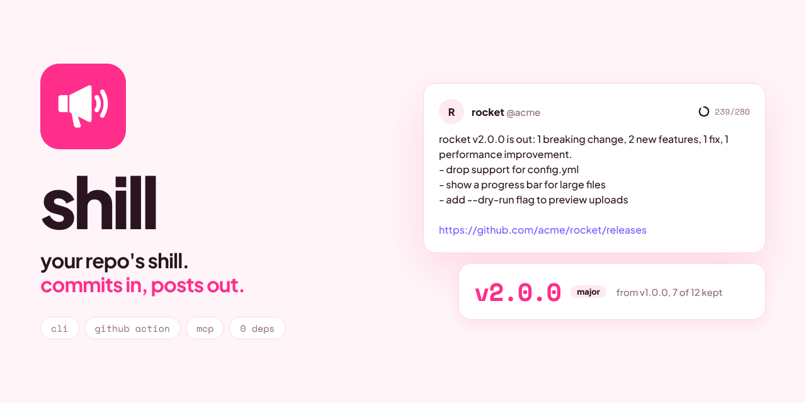
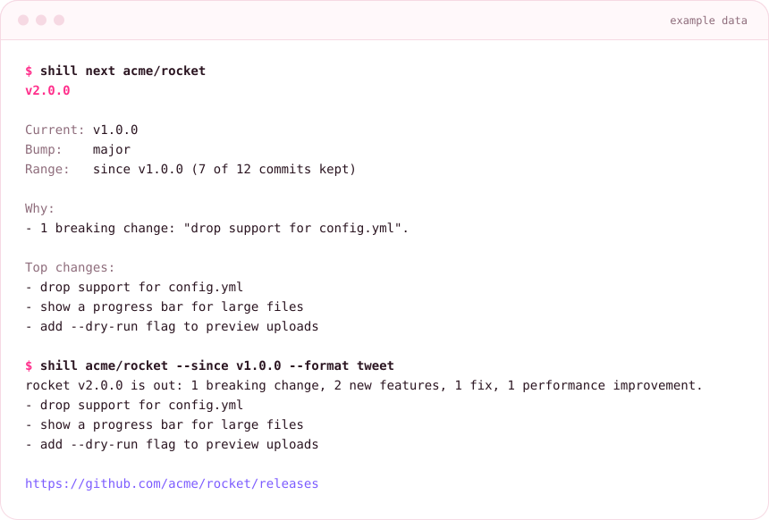
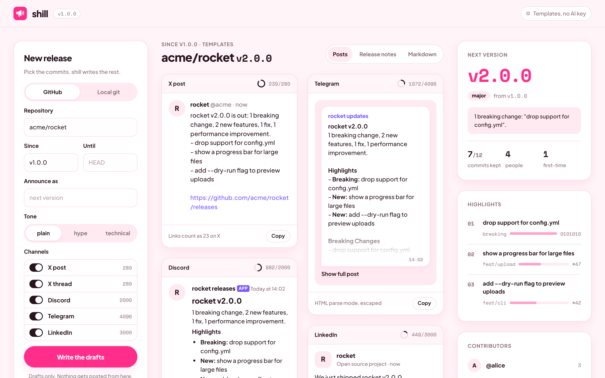
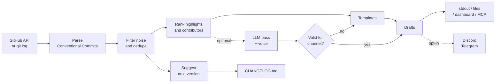

<div align="center">



<br>


# shill

**your repo's shill. commits in, posts out.**

[](LICENSE)
[](package.json)
[](package.json)
[](#use-it-from-an-ai-agent)

[Use it in your browser](#use-it-in-your-browser) · [Quick start](#quick-start) · [CLI reference](#cli-reference) · [GitHub Action](#github-action) · [MCP](#use-it-from-an-ai-agent) · [Dashboard](#dashboard) · [FAQ](#faq)

</div>

## Why

You merged the PRs and tagged the release. Now somebody has to write the notes,
pick the version number, update CHANGELOG.md, write the X thread and post in
Discord and Telegram. Usually that gets skipped, or done at 2am.

shill reads your commits (GitHub API or your local checkout), drops the noise,
ranks what matters and writes all of it. No API key needed: it fills templates
from your commit messages. Add an OpenAI or Anthropic key and the model writes the
drafts in your voice, then shill checks each one against its channel's limit
before you see it.

Zero runtime dependencies. Node 18 or newer.

## Use it in your browser

**[shillcli.com](https://shillcli.com)**: paste any public GitHub repo (`owner/repo` or a
github.com link) and click once. You get the next version and why, the release notes, a
CHANGELOG.md entry and drafts for X (single post and thread), Discord, Telegram and
LinkedIn, each previewed the way it will look, with a character count and a copy button.

- Range: since the latest release or semver tag (default), or the last 10 to 100 commits.
  A version from "last N commits" is labelled as an estimate.
- Share a result by its URL: `https://shillcli.com/?repo=honojs/hono` or
  `?repo=honojs/hono&range=commits&n=50` runs on load.
- It runs in your browser against the public GitHub API, in template mode (no AI key on
  the site). That is about 3 to 8 API calls per repo, out of the 60 an hour GitHub gives
  each visitor. When those run out, the page retries once through `/api/github`, a
  read-only proxy on the site.

## Features

| | |
| --- | --- |
| **Release notes** | Conventional Commits grouped into sections. Merges, dependency bumps, version commits, typo fixes, WIP and duplicates dropped. |
| **Next version** | `shill next`: breaking means major, feat means minor, the rest is patch. Prints the commits that decided it. |
| **CHANGELOG.md** | `shill changelog --write` inserts a Keep a Changelog section at the top. Idempotent: run it twice, same file. |
| **Every channel** | X post, numbered X thread (3 to 6 posts, each at most 280), Discord Markdown (2000), Telegram HTML (4096, escaped), LinkedIn. |
| **Highlights** | Commits scored by type, PR link and files changed. The top three lead every post. |
| **Contributors** | Leaderboard by commits, first-time contributors called out by name. |
| **Your voice** | `--voice voice.md` with a few of your past posts steers the model. |
| **Publishing** | Opt-in only: `--post discord,telegram` with explicit credentials. X is drafts only, written to files. |
| **Watch mode** | `shill watch owner/repo` polls releases and tags and posts each new release once. State on disk. |
| **Local mode** | `--local` reads `git log`, so private repos and other hosts work without the API. |
| **GitHub Action** | `uses: OWNER/shill@v1` writes the release body, drafts every post, fills the job summary. |
| **MCP server** | `shill mcp` gives Claude, Cursor and other agents 4 tools. |
| **Dashboard** | `shill ui`: every draft previewed the way it will look, side by side, with character rings and copy buttons. |

<p align="center"></p>

## Install

```sh
npm install -g shill     # installs the `shill` command
# or run it without installing
npx shill --help
```

## Quick start

```sh
# In your repo: notes and an X post since the latest tag, no API key needed
shill --local --since latest

# What should the next version be?
shill next --local

# Update CHANGELOG.md for that version
shill changelog --local --write

# A public repo through the GitHub API, every channel, drafts to files
shill owner/repo --since v1.2.0 --channels all --drafts-dir drafts/
```

Example output below, from running shill against the mock GitHub server in
`fixtures/demo-server.mjs` (example data: 12 commits in the range, 7 kept).

```text
$ shill acme/rocket --since v1.0.0
## acme/rocket: since v1.0.0

### Breaking Changes

- drop support for config.yml ([0101010](https://github.com/acme/rocket/commit/0101010101010101010101010101010101010101)) by @alice
  - use rocket.config.json instead

### Features

- **upload:** show a progress bar for large files ([0202020](https://github.com/acme/rocket/commit/0202020202020202020202020202020202020202) #47) by @dave
- **cli:** add --dry-run flag to preview uploads ([0505050](https://github.com/acme/rocket/commit/0505050505050505050505050505050505050505) #42) by @alice

### Bug Fixes

- retry uploads when the server returns 503 ([0303030](https://github.com/acme/rocket/commit/0303030303030303030303030303030303030303) #45) by @bob

### Performance

- **build:** cache compiled templates between runs ([0404040](https://github.com/acme/rocket/commit/0404040404040404040404040404040404040404) #44) by @carol

### Refactoring

- **core:** split upload queue into its own module ([0a0a0a0](https://github.com/acme/rocket/commit/0a0a0a0a0a0a0a0a0a0a0a0a0a0a0a0a0a0a0a0a)) by @carol

### Documentation

- document the --dry-run flag ([0909090](https://github.com/acme/rocket/commit/0909090909090909090909090909090909090909)) by @alice

Contributors: @alice, @carol, @bob, @dave

First-time contributors: @dave. Welcome.

----------------------------------------
X post (239/280):

rocket v2.0.0 is out: 1 breaking change, 2 new features, 1 fix, 1 performance improvement.
- drop support for config.yml
- show a progress bar for large files
- add --dry-run flag to preview uploads

https://github.com/acme/rocket/releases

----------------------------------------
Suggested version: v2.0.0 (major)
```

The five dropped commits: a merge commit, a Dependabot bump, a bare `v1.1.0`
commit, `docs: fix typo in README` and a duplicate of the 503 fix.

The same range as an X thread (`--tag v2.0.0 --channels thread`, example data):

```text
1/6 rocket v2.0.0 is out.

1 breaking change, 2 new features, 1 fix, 1 performance improvement. The highlights:
[111/280]

2/6 Breaking: drop support for config.yml. Migration: use rocket.config.json instead.
[85/280]

3/6 New in upload: show a progress bar for large files (#47).
[61/280]

4/6 New in cli: add --dry-run flag to preview uploads (#42).
[60/280]

5/6 Thanks to @alice, @carol, @bob, @dave. First contribution from @dave. Welcome.
[82/280]

6/6 Full release notes:
https://github.com/acme/rocket/releases/tag/v2.0.0
[74/280]
```

`shill changelog acme/rocket` (example data):

```markdown
## [2.0.0] - 2026-10-14

### Added

- **upload:** show a progress bar for large files (#47)
- **cli:** add --dry-run flag to preview uploads (#42)

### Changed

- **Breaking:** drop support for config.yml (0101010)
  use rocket.config.json instead
- **build:** cache compiled templates between runs (#44)
- **core:** split upload queue into its own module (0a0a0a0)

### Fixed

- retry uploads when the server returns 503 (#45)

[2.0.0]: https://github.com/acme/rocket/compare/v1.0.0...v2.0.0
```

## CLI reference

```text
shill: your repo's shill. commits in, posts out.

reads your commits, drops the noise, writes the release notes, picks the next
version and drafts the posts for x, discord, telegram and linkedin.

Usage
  shill <owner/repo> [options]        notes + post drafts from a GitHub repo
  shill --local [options]             same, from the git checkout you're in
  shill next [<owner/repo>|--local]   next semver version and the commits that decided it
  shill changelog [...] [--write]     Keep a Changelog section for the next version
  shill watch <owner/repo>            poll releases and tags, post each new one once
  shill mcp                           MCP server over stdio, for Claude, Cursor etc.
  shill ui [--port 4178]              local dashboard, drafts only

Range
  --since <ref>        tag (v1.2.0), date (2026-01-31), duration (12h, 7d, 2w) or
                       "latest" (newest semver tag). default: all history
                       (next and changelog default to latest)
  --until <ref>        branch, tag or SHA to stop at. default: default branch / HEAD
  --local              read commits with git from a local checkout, no GitHub API
  --dir <path>         checkout for --local. default: current directory
  --max-commits <n>    stop after this many commits. default: 200

Output
  --channels <list>    x, thread, discord, telegram, linkedin or all. default: x
  --tag <version>      version to announce (and changelog heading). default: the
                       suggested next version when --since is a tag
  --format <fmt>       markdown | tweet | both | json. default: both
  --json               same as --format json
  --out <file>         write output to a file instead of stdout
  --drafts-dir <dir>   write notes.md and one file per channel draft to <dir>
  --write              (changelog) insert the section into CHANGELOG.md
  --file <path>        (changelog) changelog path. default: CHANGELOG.md

AI (optional, templates without a key)
  --provider <name>    openai | anthropic | none. default: openai if OPENAI_API_KEY
                       is set, else anthropic if ANTHROPIC_API_KEY is set, else none
  --model <name>       default: gpt-4o-mini or claude-3-5-haiku-latest
  --tone <tone>        plain | hype | technical. default: plain
  --voice <file>       a few of your past posts, so the drafts sound like you

Posting (off unless you pass these; x is always drafts only)
  --post <list>        discord, telegram
  --discord-webhook <url>
  --telegram-token <token>  --telegram-chat <chat id>

Watch, dashboard
  --interval <sec>     poll interval for watch. default: 300
  --state <file>       watch state file. default: .shill-state.json
  --once               poll once and exit
  --port <n>           dashboard port. default: 4178.  --host <addr> default: 127.0.0.1

  -h, --help           show this help.     -v, --version   show the version

Environment
  GITHUB_TOKEN, OPENAI_API_KEY, ANTHROPIC_API_KEY
  SHILL_GITHUB_API, SHILL_LLM_BASE, SHILL_TELEGRAM_API   API base URLs
```

Exit codes: `0` success, `1` runtime error (API, git, network), `2` usage error.

### Channels

| Channel | Flag | Format | Limit |
| --- | --- | --- | --- |
| X post | `x` | plain text, no hashtags, no emojis | 280 |
| X thread | `thread` | 3 to 6 posts numbered `1/5` | 280 per post |
| Discord | `discord` | Markdown, PR links without embeds, no mentions pinged | 2000 |
| Telegram | `telegram` | HTML parse mode, all commit text escaped | 4096 |
| LinkedIn | `linkedin` | plain text, short paragraphs | 3000 |

Counts are Unicode code points. X counts every link as 23 characters, so real
posts with links are a little shorter than the count shown.

### Publishing

```sh
shill owner/repo --since latest --post discord --discord-webhook "$DISCORD_WEBHOOK"
shill owner/repo --since latest --post telegram --telegram-token "$TG_TOKEN" --telegram-chat @mychannel
```

Discord uses the [execute webhook](https://discord.com/developers/docs/resources/webhook#execute-webhook)
endpoint with `allowed_mentions` empty. Telegram uses the Bot API
[sendMessage](https://core.telegram.org/bots/api#sendmessage) method with
`parse_mode: HTML`. shill never posts to X: use `--drafts-dir` and post the files yourself.

### Watch mode

```sh
shill watch owner/repo --interval 300 --channels x,thread,discord \
  --post discord --discord-webhook "$DISCORD_WEBHOOK" --drafts-dir drafts/
```

Each poll calls `GET /repos/{owner}/{repo}/releases` and `GET /repos/{owner}/{repo}/tags`.
The first poll records what already exists and posts nothing. Each new release (or
semver tag without a release) gets notes since the previous semver tag, drafts in
`drafts/<tag>/`, and one post per channel. The state file records which channels
were posted, so a restart never posts twice. A failed channel is retried on the next
two polls, then given up and logged in the state file.

## GitHub Action

```yaml
on:
  release:
    types: [published]
permissions:
  contents: write
jobs:
  shill:
    runs-on: ubuntu-latest
    steps:
      - id: shill
        uses: OWNER/shill@v1
        with:
          channels: x,thread,discord,telegram,linkedin
          openai_api_key: ${{ secrets.OPENAI_API_KEY }}   # optional
          post: discord                                    # optional, opt-in
          discord_webhook: ${{ secrets.DISCORD_WEBHOOK }}
      - uses: actions/upload-artifact@v4
        with:
          name: shill-drafts
          path: ${{ steps.shill.outputs.drafts_dir }}
```

The action finds the previous semver tag, writes the notes into the release body
between `<!-- shill:start -->` and `<!-- shill:end -->` (anything you wrote
yourself stays), writes every draft to `drafts_dir`, and adds the drafts to the job
summary. Uploading artifacts needs the `actions/upload-artifact` step shown above,
because a zero-dependency action cannot talk to the artifact service itself.

| Input | Default | |
| --- | --- | --- |
| `github_token` | `${{ github.token }}` | Reads commits, edits the release |
| `tag` | release event tag | Release to write notes for |
| `since` | previous semver tag | Start of the range |
| `channels` | `x,thread,discord,telegram,linkedin` | Drafts to write |
| `tone`, `provider`, `model`, `voice` | | Same as the CLI |
| `openai_api_key`, `anthropic_api_key` | | Pass secrets |
| `update_release` | `true` | Write notes into the release body |
| `drafts_dir` | `shill-drafts` | Where drafts go |
| `post` | empty | `discord`, `telegram` (opt-in) |
| `discord_webhook`, `telegram_token`, `telegram_chat` | | Pass secrets |

Outputs: `notes`, `next_version`, `drafts_dir`, `tweet`. A copy-paste workflow is in
[`examples/shill-action.yml`](examples/shill-action.yml).

## Use it from an AI agent

`shill mcp` runs a [Model Context Protocol](https://modelcontextprotocol.io) server
over stdio. Add it to Claude Desktop (`claude_desktop_config.json`), Claude Code
(`.mcp.json`) or Cursor:

```json
{
  "mcpServers": {
    "shill": {
      "command": "npx",
      "args": ["-y", "shill", "mcp"],
      "env": { "GITHUB_TOKEN": "optional", "OPENAI_API_KEY": "optional" }
    }
  }
}
```

| Tool | What it does |
| --- | --- |
| `release_notes` | Markdown notes for a range plus highlights, contributors and stats. |
| `next_version` | Next semver with the reasons, since the latest tag by default. |
| `draft_posts` | Drafts for any of `x`, `thread`, `discord`, `telegram`, `linkedin` with character counts. Never posts. |
| `changelog_entry` | Keep a Changelog section; with `write: true` and `local_path` it updates CHANGELOG.md. |

Every tool takes `repo` (owner/repo) or `local_path` (a checkout), plus `since` and `until`.
Real exchange against the mock server (example data, output shortened):

```text
-> {"jsonrpc":"2.0","id":3,"method":"tools/call","params":{"name":"next_version","arguments":{"repo":"acme/rocket"}}}
<- {"jsonrpc":"2.0","id":3,"result":{"content":[{"type":"text","text":"{\n  \"repo\": \"acme/rocket\",\n  \"range\": \"since v1.0.0\",\n  \"current\": \"v1.0.0\",\n  \"next\": \"v2.0.0\",\n  \"bump\": \"major\", ..."}]}}
```

## Dashboard

```sh
shill ui              # prints http://127.0.0.1:4178/
```

Pick a GitHub repo or a local checkout and a range. Every draft shows up as a
preview of how it will look on X, Discord, Telegram and LinkedIn, side by side, each
with a character ring and a copy button. The right column has the next version and
why, the ranked highlights and the contributors. The notes are one tab over, as a
preview or raw Markdown. It binds to 127.0.0.1 and never posts anything.

<p align="center"></p>

## Programmatic API

```js
import { shill, nextVersion, changelogEntry } from 'shill';

const r = await shill({ repo: 'owner/repo', since: 'latest', channels: ['x', 'thread', 'discord'] });
r.markdown;     // release notes
r.posts.thread; // ['1/5 ...', ...]
r.counts;       // { x: { length, limit }, thread: [...], discord: {...} }
r.version;      // { current, next, bump, reasons } when since is a tag
r.highlights;   // top 3 entries with scores
r.contributors; // [{ name, login, commits, firstTime }, ...]

await nextVersion({ local: true, dir: '.' });                 // { current, next, bump, reasons, ... }
await changelogEntry({ local: true, dir: '.', write: true }); // updates ./CHANGELOG.md
```

Also exported: `publish`, `postDiscord`, `postTelegram`, `writeDrafts`, `renderPosts`,
`parseChannels`, `suggestNext`, `pickHighlights`, `leaderboard`, `insertSection` and the
0.1 helpers (`analyze`, `renderMarkdown`, `templateTweet`, ...).

## How it works



Only commit subjects, scopes, PR numbers, author handles and the version are sent
to the model. Never code or diffs.

## Configuration

| Variable | Purpose |
| --- | --- |
| `GITHUB_TOKEN` | Private repos and higher rate limits. The Action passes it for you. |
| `OPENAI_API_KEY` | Enables the OpenAI provider. |
| `ANTHROPIC_API_KEY` | Enables the Anthropic provider. |
| `SHILL_GITHUB_API` | GitHub API base URL. Default `https://api.github.com` (set it for GitHub Enterprise). |
| `SHILL_LLM_BASE` | LLM API base URL. Default: the provider's public API. |
| `SHILL_TELEGRAM_API` | Telegram Bot API base URL. Default `https://api.telegram.org`. |

### Hosting the website

`docs/` is the static site and `api/github.js` its one serverless function, deployed on
Vercel as is (`vercel.json`, no build step). The browser code imports copies of the pure
modules in `docs/lib/`; after editing `src/`, run `node scripts/sync-docs-lib.mjs`
(a test fails when they drift). `node scripts/dev-site.mjs` serves the site locally with
the function routed the way Vercel does.

| Optional env var (Vercel) | Effect |
| --- | --- |
| `GITHUB_TOKEN` | The `/api/github` fallback uses it, so visitors who hit their own 60 calls an hour share a 5000 an hour budget. Without it the fallback still works, unauthenticated. Any token with public read access is enough. |

## FAQ

**Do I need an AI key?** No. The templates are deterministic and always within limits.
With a key, the model writes the prose and shill validates it; a draft that breaks
a channel's rules falls back to the template with a warning.

**My commits are not Conventional Commits.** They still show up, under Other Changes, and
count as a patch bump for `next`. Conventional Commits give you better notes.

**Why "v2.0.0 is out" when I have not tagged it?** When `--since` is a tag and you pass no
`--tag`, posts announce the suggested next version. Pass `--tag v1.5.0` to announce something else.

**How are first-time contributors found?** Through the API: a contributor with no commits
before the start of the range. Locally: an author name or noreply login that does not
appear before the range. With `--since` left as all history, nobody is flagged.

**Does it post to X?** No. X drafts go to files, the dashboard and the job summary.

**Is the dashboard safe to run?** It binds to 127.0.0.1, rejects other Host headers and has
no posting endpoints.

## Roadmap

- [ ] Bluesky and Mastodon drafts
- [ ] `--post` for Slack incoming webhooks
- [ ] Group commits by PR using the pulls API when a PR has several commits
- [ ] Monorepo support: notes per package path
- [ ] Watch several repos from one state file
- [ ] Image card for each release (version, highlights) rendered to PNG

## Contributing

See [CONTRIBUTING.md](CONTRIBUTING.md). Tests run offline: `npm test`.
Please read the [Code of Conduct](CODE_OF_CONDUCT.md) and report security issues as
described in [SECURITY.md](SECURITY.md). Brand assets and rules are in [BRAND.md](BRAND.md).

$SHILL is the community token for this project. The tool is MIT licensed and works
without it. Nothing in this repo is financial advice.

## License

[MIT](LICENSE)
